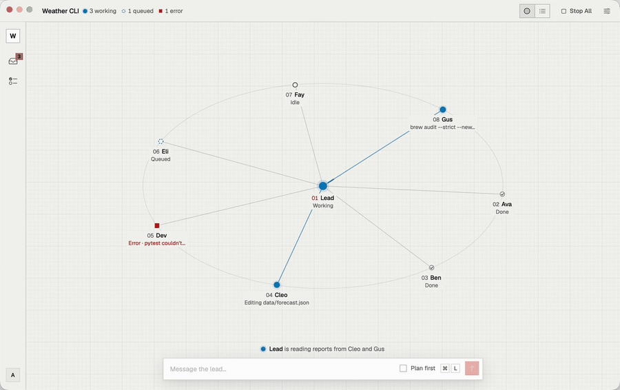
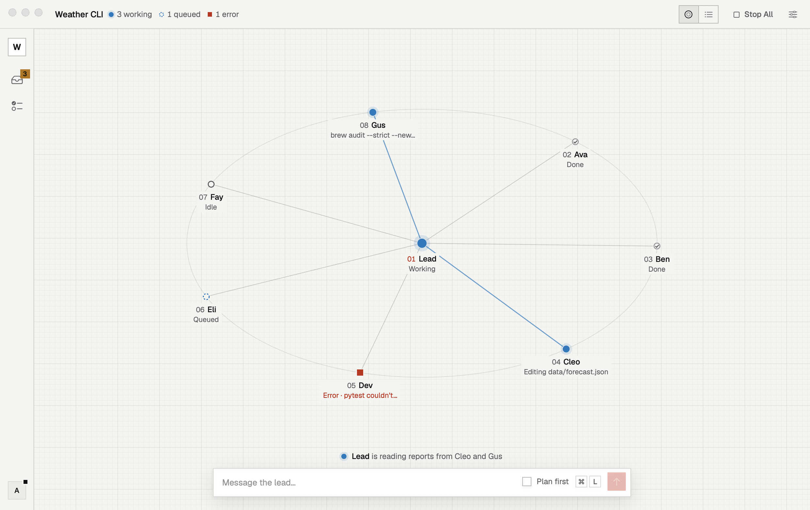
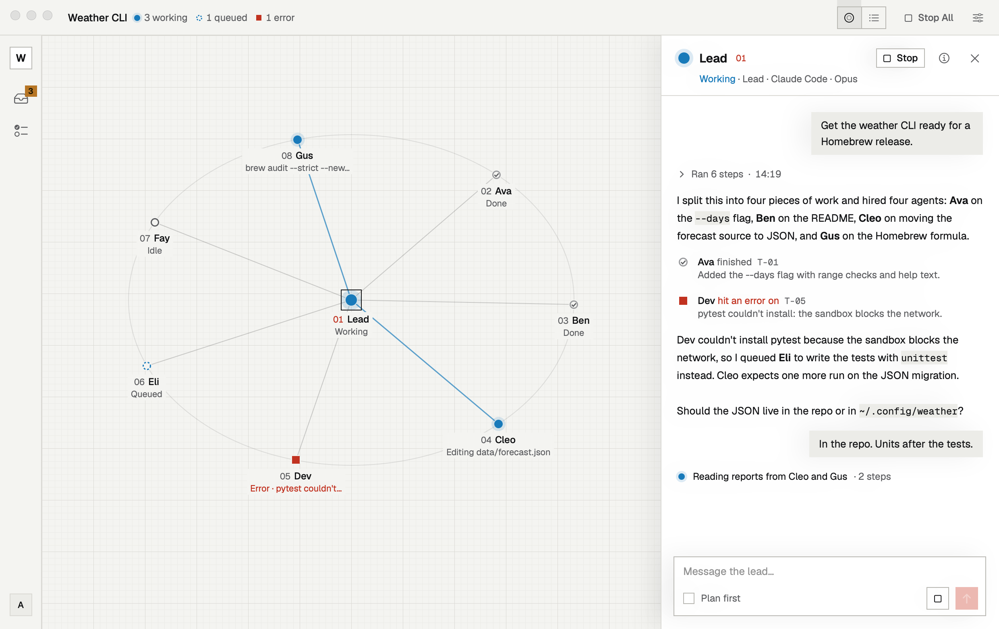
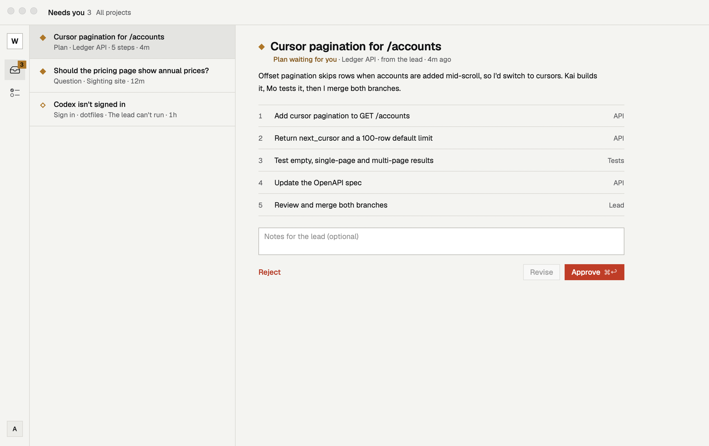
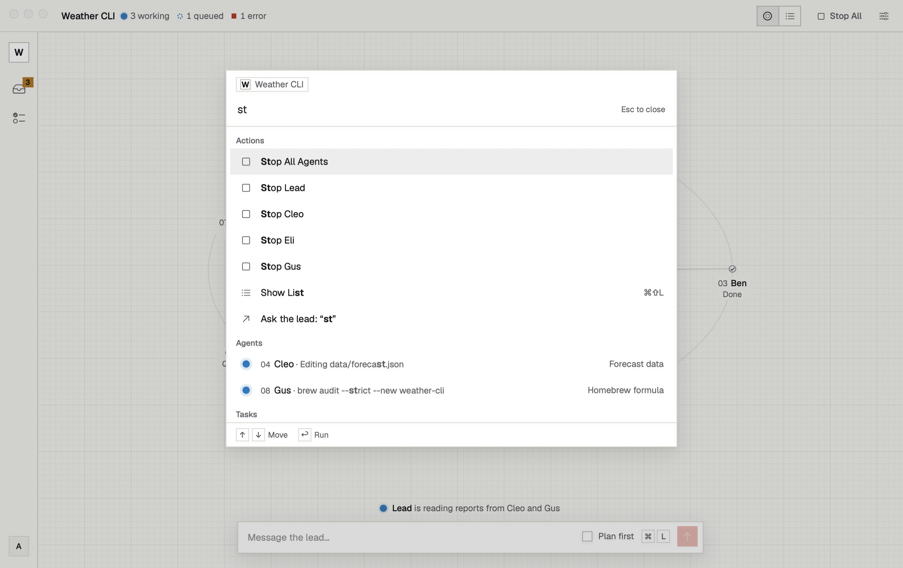
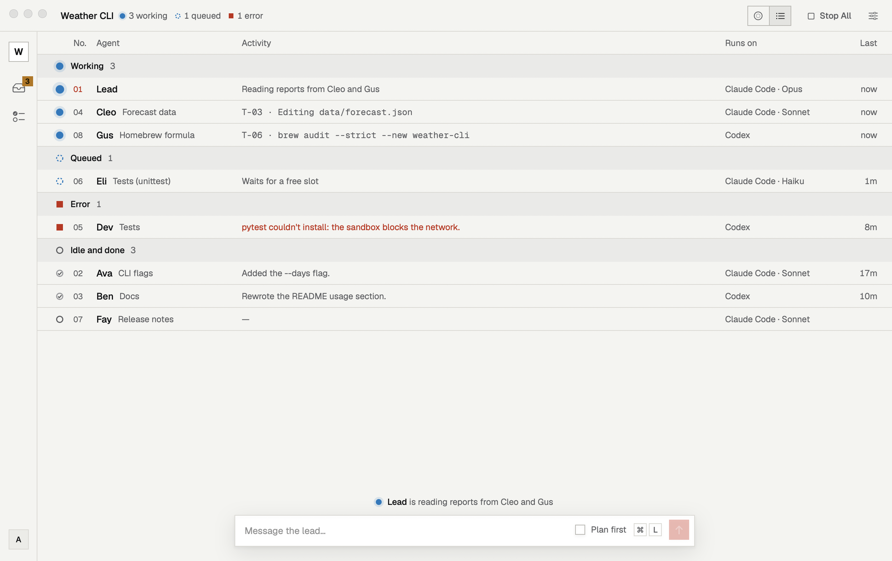
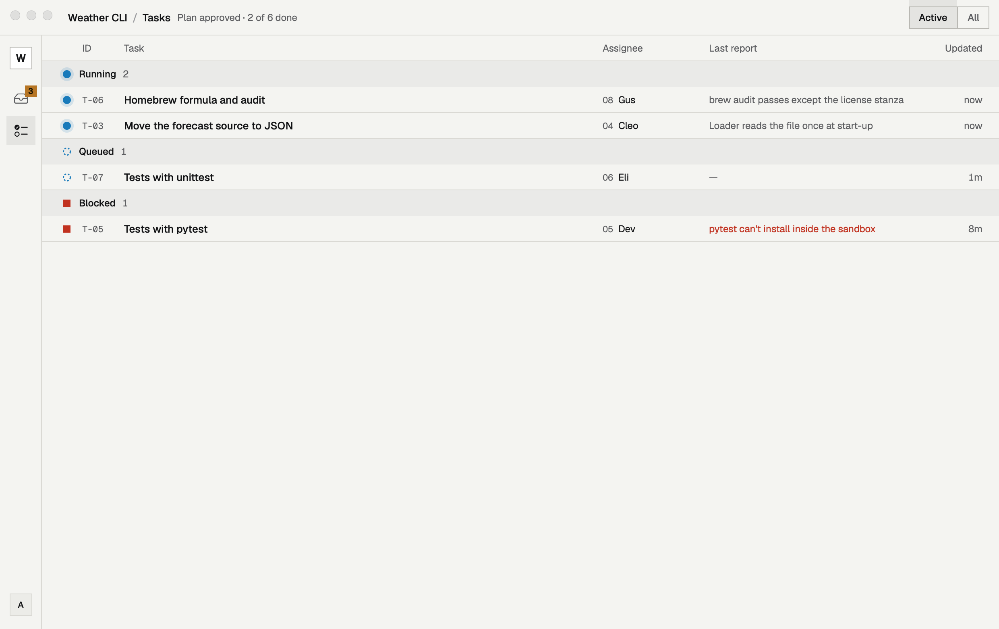

  
   30-second tour · <a href="docs/demo.mp4">watch in full quality</a>

<h1 align="center">Sighting</h1>

  <b>Turn the coding agents you already have into a team.</b> 
  One lead per project. You talk to the lead; it hires agents, hands out the work, and reports back.

  <a href="https://github.com/ompatel-24/sighting-releases/releases/latest/download/Sighting.dmg"><b>Download for macOS</b></a>
  &nbsp;·&nbsp; macOS 14 Sonoma or later
  &nbsp;·&nbsp; <a href="https://github.com/ompatel-24/sighting-releases/releases">Release notes</a>

---

## What it does

You give the lead a goal, like *"get the weather CLI ready for a Homebrew release"*. The lead splits it into tasks, hires agents for them, and tracks the work until it's done. Each agent works on its own git branch, and the lead merges the results.

The agents are your own CLIs, **Claude Code** and **Codex**, running on your Mac in the project folder with your existing subscriptions. Sighting doesn't run them in the cloud and doesn't need its own API keys.

## The constellation

Your team is drawn as a constellation. The lead sits at the centre, and every agent it hires gets a star and a line. A line lights up while that agent is working, with a pulse travelling from the lead to the agent. Stars show each agent's state: working, queued, done, error, or waiting on you. Drag a star to play with it, or click it to see what that agent is doing.

  <picture>
    <source media="(prefers-color-scheme: dark)" srcset="docs/main-dark.png">
    
  </picture>

## Talk to the lead

  <picture>
    <source media="(prefers-color-scheme: dark)" srcset="docs/sheet-lead-dark.png">
    
  </picture>

Click the lead, or press <kbd>⌘</kbd><kbd>L</kbd>, and its chat slides in beside the constellation. Replies read like a document, and the agent's tool steps fold into one line you can expand. Turn on **Plan first** when you want the lead to propose a plan before anyone is hired.

## Approve plans, answer questions

  <picture>
    <source media="(prefers-color-scheme: dark)" srcset="docs/needs-dark.png">
    
  </picture>

**Needs you** collects everything waiting on you across every project: plans to approve, questions from the lead, and CLIs that need signing in. Approve with <kbd>⌘</kbd><kbd>↩</kbd>, or add notes and send the plan back.

## Everything from the keyboard

  <picture>
    <source media="(prefers-color-scheme: dark)" srcset="docs/cmdk-query-dark.png">
    
  </picture>

| Shortcut | Does |
|---|---|
| <kbd>⌃</kbd><kbd>⌥</kbd><kbd>Space</kbd> | Open the notch and message the lead from any app |
| <kbd>⌘</kbd><kbd>K</kbd> | Jump to an agent, task or action, or ask the lead anything |
| <kbd>⌘</kbd><kbd>L</kbd> | Chat with the lead |
| <kbd>⌘</kbd><kbd>⇧</kbd><kbd>L</kbd> | Switch between the constellation and the list |
| <kbd>⌘</kbd><kbd>1</kbd> · <kbd>2</kbd> · <kbd>3</kbd> | Constellation · Needs you · Tasks |
| <kbd>⌘</kbd><kbd>⇧</kbd><kbd>O</kbd> | Switch project |

## Team and tasks at a glance

<table>
  <tr>
    <td width="50%">
      <picture>
        <source media="(prefers-color-scheme: dark)" srcset="docs/list-dark.png">
        
      </picture>
      
The list view shows each agent's state, activity and model.

    </td>
    <td width="50%">
      <picture>
        <source media="(prefers-color-scheme: dark)" srcset="docs/tasks-dark.png">
        
      </picture>
      
Tasks shows every task in the plan, who has it, and the last report.

    </td>
  </tr>
</table>

## The notch

Sighting lives at the top of your screen. Hover the notch, or press <kbd>⌃</kbd><kbd>⌥</kbd><kbd>Space</kbd>, to see whether the team is working and to send the lead a message without leaving what you're doing. On Macs without a notch, Sighting draws one under the menu bar.

## Get started

1. [Download Sighting](https://github.com/ompatel-24/sighting-releases/releases/latest/download/Sighting.dmg), open the DMG and drag Sighting into Applications.
2. Sign in with your email. Sighting sends you a 6-digit code; there's no password.
3. Install and sign in to at least one agent CLI: [Claude Code](https://code.claude.com/docs) or [Codex](https://github.com/openai/codex).
4. Pick a project folder and say hello to your lead.

Sighting is signed with a Developer ID and notarized by Apple. Updates download in the background and install when you choose **Update and Restart**, or the next time you quit.

> [!IMPORTANT]
> Agents run your CLIs in their full-access mode inside the project folder, so they can edit files and run commands without asking. Use Sighting on folders under version control, and only on projects you trust.

Screenshots show example projects.

---

## About this repository

This repository is Sighting's public update feed. CI in the private source repository publishes each build here:

- `appcast.xml`: the Sparkle update feed, served by GitHub Pages at https://updates.sighting.dev/appcast.xml
- [Releases](https://github.com/ompatel-24/sighting-releases/releases): the signed app zips the feed points to, plus the DMG

Don't edit `appcast.xml` by hand; every item carries an EdDSA signature.
